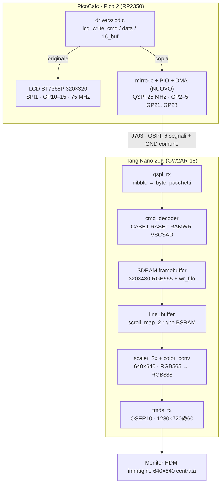

# PicoCalc HDMI Mirror – Documento di progetto

30 ottobre 2026 · Jobond (giovanni.pozzobon@aton.com)

## 1. Obiettivo e decisioni

Una Tang Nano 20K, collegata al connettore J703 del PicoCalc, replica su HDMI l'intero contenuto del display 320×320 (specchio grafico completo, RGB565). Il Pico invia alla FPGA una copia di ogni comando e dato che manda all'LCD; la FPGA ricostruisce l'immagine e la mostra su un monitor.

**Decisioni prese**

| Tema | Decisione | Motivo |
| --- | --- | --- |
| Funzione | Specchio grafico completo del display | Richiesta del committente |
| Scheda FPGA | Tang Nano 20K (GW2AR-18) | 828 Kbit BSRAM e SDRAM 64 Mbit: margine per framebuffer, scaler e audio futuro |
| PSRAM PicoCalc | Non usata, tenuta disabilitata | Libera GP2–GP5 e GP21 su J703 |
| Collegamento | QSPI unidirezionale Pico → FPGA su J703 (6 segnali) | Unici pin liberi della scheda madre |
| Firmware di riferimento | `picocalc-text-starter` (C, Pico SDK, board `pico2`) | Codice disponibile e modificabile |
| Uscita video | 1280×720@60, scala 2× (640×640 centrato); ripiego 640×480 | Scala intera, nitida |

**Fuori ambito (fase 1):** firmware non modificabili (MicroPython, PicoMite, NES), audio su HDMI, canale di ritorno FPGA → Pico, sniffing del bus SPI dell'LCD.

## 2. Vincoli hardware del PicoCalc

L'unico accesso utente ai GPIO è J703, con 6 segnali; tutti gli altri pin sono già usati. Fonte: `clockwork_Mainboard_V2.0_Schematic.pdf` e driver di `picocalc-text-starter`.

**Mappa GPIO del Pico sulla scheda madre**

| GPIO | Uso | Disponibile |
| --- | --- | --- |
| GP0, GP1 | UART0 (anche su J702) | No |
| GP2, GP3, GP4, GP5 | PSRAM: RAM_TX, RAM_RX, RAM_IO2, RAM_IO3 — esposti su J703 | **Sì** (PSRAM non usata) |
| GP6, GP7 | I2C1 verso il controller tastiera (SDA, SCL) | No |
| GP8, GP9 | UART1 | No |
| GP10–GP15 | LCD su SPI1: SCK, TX, RX, CS, D/C, RESET (75 MHz) | No |
| GP16–GP19, GP22 | SD card su SPI0 + card detect | No |
| GP20 | PSRAM RAM_CS (non su J703) | Va tenuto **alto** |
| GP21 | PSRAM RAM_SCK — esposto su J703 | **Sì** |
| GP26, GP27 | Audio PWM sinistro/destro | No |
| GP28 | Libero — esposto su J703 | **Sì** |

**Pinout di J703**

| Pin | Segnale |
| --- | --- |
| 1 | 3V3_OUT |
| 2 | GP2 |
| 3 | GP3 |
| 4 | GP4 |
| 5 | GP5 |
| 6 | GP21 |
| 7 | GP28 |
| 8 | GND |

**Caratteristiche del display da replicare** (da `drivers/lcd.c` e `lcd.h`)

- Controller ST7365P, area visibile 320×320, memoria interna 320×480 (`FRAME_HEIGHT 480`).
- `COLMOD 0x55`: RGB565, 16 bit per pixel, MSB first.
- `MADCTL 0x48`: specchio colonne (MX) e ordine BGR. `INVON`: inversione colori attiva.
- Scroll hardware con `VSCRDEF` (aree fissa alta, scorrevole, fissa bassa) e `VSCSAD` (inizio area scorrevole). Il terminale scorre cambiando VSCSAD senza ridisegnare.
- Tutte le scritture di pixel passano da `lcd_blit()` → `lcd_set_window()` (CASET, RASET, RAMWR) → `lcd_write16_buf()`.

Nessun pin della PicoCalc offre l'HDMI diretto: PicoDVI richiede 8 pin, e l'HSTX dell'RP2350 usa GP12–GP19, già occupati da LCD e SD. Per questo serve la FPGA.

## 3. Architettura

Il driver LCD invia ogni comando sia al display sia, in copia, alla FPGA; la FPGA ricostruisce la memoria del display in SDRAM e la serializza su HDMI.

Il blocco `mirror.c + PIO + DMA` è l'unico componente nuovo lato Pico. Il generatore di clock (PLL) alimenta tutti i moduli FPGA e non è disegnato.

## 4. Collegamento fisico e protocollo

Un bus QSPI unidirezionale (4 dati + clock + chip select) trasporta pacchetti che replicano 1:1 le transazioni SPI verso l'LCD. Il primo byte del pacchetto sostituisce il pin D/C.

**Cablaggio J703 → Tang Nano 20K**

| J703 | GPIO Pico | Segnale | Pin Tang Nano 20K |
| --- | --- | --- | --- |
| 2 | GP2 | D0 (bit 0 del nibble) | 73 (IOT40A) |
| 3 | GP3 | D1 | 74 (IOT34B) |
| 4 | GP4 | D2 | 75 (IOT34A) |
| 5 | GP5 | D3 (bit 3 del nibble) | 77 (IOT30A) |
| 6 | GP21 | SCK | 76 (IOT30B) |
| 7 | GP28 | CS_N (attivo basso) | 86 (IOT4A) |
| 8 | GND | GND comune | GND |
| 1 | 3V3_OUT | **non collegato** | — |

**Regole elettriche**

- Livelli LVCMOS 3,3 V: tutti i pin scelti stanno su banchi a 3,3 V (pinlabel Sipeed). Scelti tra quelli senza funzione on-board attiva (esclusi 85/80 SDIO, 52/53 EDID, 15–20 LED). SCK non serve su ingresso clock-capable: `qspi_rx` lo campiona con `sys_clk`. Vincoli in `fpga/constraints/link_qspi.cst`; pin da riverificare sullo schema prima del cablaggio.
- La FPGA è alimentata dalla propria USB-C; solo GND in comune con il PicoCalc.
- Cavi ≤ 10 cm, resistenze serie 33 Ω lato Pico su SCK e dati, un filo GND vicino a SCK.
- Clock: 10 MHz in bring-up, obiettivo 25 MHz, massimo 40 MHz dopo verifica con analizzatore logico.

**Temporizzazione**

- Il Pico cambia i dati sul fronte di discesa di SCK; la FPGA campiona sul fronte di salita.
- Ogni byte viaggia in 2 cicli: prima il nibble alto (bit 7–4), poi il basso (bit 3–0).
- SCK fermo a livello basso quando CS_N è alto. Tempo minimo CS_N alto tra due pacchetti: 200 ns.

**Formato pacchetto** (delimitato da CS_N basso → alto)

| Byte 0 (tipo) | Contenuto successivo | Equivale su LCD a |
| --- | --- | --- |
| `0x00` CMD | 1 byte: codice comando ST7365P | D/C = 0 |
| `0x01` DATA | N byte di parametri o pixel (RGB565 MSB first) | D/C = 1 |
| `0x80` CTRL | 1 byte: `0x01` = reset dello stato dello specchio; `0x02` = congela i contatori del test LFSR (solo `linktest`, ignorato dal decoder) | — (solo collegamento) |

La lunghezza è implicita: finisce al rilascio di CS_N. Un pacchetto DATA può contenere un'intera finestra di pixel (fino a 320×480×2 = 307.200 byte).

**Banda**

- LCD: 75 MHz × 1 bit ≈ 9,4 MB/s.
- Collegamento a 25 MHz × 4 bit = 12,5 MB/s, superiore all'LCD: lo specchio non rallenta mai il display.
- Un frame completo (320×320×2 = 204.800 byte) richiede circa 16 ms a 25 MHz.

## 5. Specifica firmware Pico

Un nuovo modulo `drivers/mirror.{c,h}` con `mirror.pio`, attivato dal flag CMake `PICOCALC_HDMI_MIRROR`, duplica ogni transazione LCD sul collegamento QSPI. Senza il flag il firmware resta identico all'attuale.

**API del modulo**

| Funzione | Comportamento |
| --- | --- |
| `mirror_init()` | GP20 uscita alta (PSRAM off); GP28 uscita alta; carica il PIO; invia `CTRL 0x01` |
| `mirror_cmd(uint8_t cmd)` | Pacchetto `0x00, cmd` |
| `mirror_data(const uint8_t *buf, size_t n)` | Pacchetto `0x01` + n byte |
| `mirror_data16_start(const uint16_t *buf, size_t n)` | Apre il pacchetto `0x01` e avvia il DMA dei pixel, MSB first, senza bloccare |
| `mirror_wait()` | Attende DMA terminato, FIFO vuota e PIO in stallo, poi alza CS_N |

**Programma PIO**

- `out pins, 4` con `out_base` = GP2 e 4 pin; clock su GP21 come side-set a 1 bit; 2 istruzioni per ciclo di SCK (`out pins,4 side 0` / `nop side 1`).
- Shift a sinistra (MSB first) con autopull. Byte singoli: DMA a 8 bit, soglia 8. Pixel: DMA a 16 bit, soglia 16, così ogni halfword esce nell'ordine alto → basso come sull'LCD.
- Divisore di clock calcolato da `clock_get_hz(clk_sys)` per ottenere la frequenza SCK configurata (default 25 MHz).
- CS_N su GP28 gestito via software, perché non è adiacente a GP21. Si alza solo dopo `mirror_wait()`.

**Punti di aggancio in `drivers/lcd.c`**

| Funzione esistente | Aggiunta |
| --- | --- |
| `lcd_write_cmd()` | `mirror_cmd()` |
| `lcd_write_data()` | `mirror_data()` con gli stessi byte |
| `lcd_write16_data()` | `mirror_data()` con ogni halfword in ordine alto → basso |
| `lcd_write16_buf()` | `mirror_data16_start()` prima della `spi_write16_blocking()`, `mirror_wait()` dopo: i due trasferimenti corrono in parallelo |
| `lcd_init()` | `mirror_init()` prima del primo comando |

Le letture (RAMRD) non vanno replicate. Ogni pacchetto deve restare nella stessa sezione con interrupt disabilitati già usata da `lcd.c`, così comando e dati non si mescolano.

**Criteri di qualità**

- Con il flag attivo il display LCD funziona esattamente come prima, e il tempo di `lcd_blit()` cresce al massimo del 5% (misurato con `time_us_64()`).
- Nessun uso della PSRAM nel firmware; GP20 resta alto per tutta l'esecuzione.
- Un comando di shell `hdmi` (in `commands.c`) mostra stato e frequenza del collegamento e invia `CTRL 0x01`.

## 6. Specifica gateware FPGA (Tang Nano 20K)

La FPGA riceve i pacchetti, imita il sottoinsieme ST7365P usato da `lcd.c`, tiene una copia della memoria del display in SDRAM e la mostra a 720p con scala 2×. Linguaggio: Verilog; toolchain: Gowin EDA, oppure Yosys + nextpnr se il supporto alla GW2AR-18 risulta completo.

**Moduli**

| Modulo | Dominio di clock | Funzione |
| --- | --- | --- |
| `clk_gen` | — | PLL dall'oscillatore di bordo: `sys_clk` (≥ 4× SCK, es. 100–150 MHz), `pix_clk` 74,25 MHz, `tmds_clk` 371,25 MHz (5×) |
| `qspi_rx` | sys_clk | Sincronizza SCK, CS_N, D[3:0] con 2 flip-flop; sul fronte di salita di SCK compone i nibble in byte; emette byte con flag inizio/fine pacchetto |
| `cmd_decoder` | sys_clk | Macchina a stati ST7365P (tabella sotto); produce scritture pixel (indirizzo, RGB565) |
| `wr_fifo` | sys_clk | Coda di scritture verso la SDRAM, assorbe i picchi del collegamento |
| `sdram_ctrl` + arbitro | sys_clk | Lettura righe ad alta priorità, scritture nei tempi liberi, refresh |
| `line_buffer` | sys → pix | Doppio buffer in BSRAM da 320×16 bit: una riga si legge mentre l'altra si carica |
| `scroll_map` | sys_clk | Converte la riga visibile nella riga di memoria secondo VSCRDEF/VSCSAD |
| `video_timing` | pix_clk | 1280×720@60: H 1280 + 110 + 40 + 220 = 1650, V 720 + 5 + 5 + 20 = 750, sync positivi |
| `scaler_2x` | pix_clk | Finestra 640×640 a x = 320, y = 40; ogni pixel e ogni riga ripetuti 2 volte; fuori finestra nero |
| `color_conv` | pix_clk | RGB565 → RGB888 per replica dei bit alti; parametri `SWAP_RB` e `INVERT` per la taratura |
| `tmds_tx` | pix/tmds | Encoder TMDS (DVI) + OSER10 + uscite differenziali; IP DVI TX di Gowin o core open source |

**Comandi da implementare in `cmd_decoder`**

| Comando | Codice | Parametri | Azione |
| --- | --- | --- | --- |
| SWRESET | 0x01 | 0 | Registri ai valori di default |
| CASET | 0x2A | 4 (XS, XE a 16 bit) | Imposta colonne della finestra |
| RASET | 0x2B | 4 (YS, YE a 16 bit) | Imposta righe della finestra |
| RAMWR | 0x2C | N | Cursore a (XS, YS); ogni 2 byte un pixel; x++ e a fine riga x = XS, y++; oltre YE scarta |
| VSCRDEF | 0x33 | 6 (TFA, VSA, BFA) | Definisce le aree di scroll |
| MADCTL | 0x36 | 1 | Memorizza; usato solo per la taratura dell'orientamento |
| VSCSAD | 0x37 | 2 | Inizio dell'area scorrevole in memoria |
| INVOFF / INVON | 0x20 / 0x21 | 0 | Memorizza lo stato di inversione |
| DISPOFF / DISPON | 0x28 / 0x29 | 0 | Uscita nera / immagine |
| Altri | — | qualsiasi | Consumati e ignorati |

`CTRL 0x01` del collegamento azzera lo stato del decoder senza toccare la memoria.

**Memoria**

- Immagine 320×480 a 16 bit = 307.200 byte nella SDRAM da 64 Mbit (32 bit di bus): 2 pixel per parola, 160 parole per riga, scrittura del singolo pixel con le maschere DQM.
- Banda di lettura: una riga di 640 byte ogni 2 righe video (circa 44 µs), ampiamente sotto la capacità della SDRAM.

**Scroll**

Per una riga visibile v: se v < TFA, riga = v; se TFA ≤ v < TFA + VSA, riga = TFA + ((v − TFA + VSCSAD − TFA) mod VSA); altrimenti riga = v. La formula va confermata su `ST7365P_SPEC_V1.0.pdf` (nella cartella `PicoCalc_job`) e a banco, confrontando LCD e HDMI durante lo scroll del terminale.

**Ripiego video:** 640×480@60 (pixel clock 25,175 MHz, accettabile 25,2 MHz) con immagine 1:1 centrata a x = 160, y = 80. Selezionabile con un parametro in sintesi.

## 7. Piano di sviluppo

Cinque fasi, ognuna chiusa da un criterio verificabile prima di passare alla successiva.

1. **HDMI dalla sola FPGA** — `clk_gen`, `video_timing`, `tmds_tx` con barre di colore.
   - Accettazione: il monitor mostra le barre a 1280×720@60 senza sfarfallio per 10 minuti; idem a 640×480.
2. **Collegamento QSPI** — `mirror.pio` e `mirror_init()` sul Pico, `qspi_rx` sulla FPGA.
   - Accettazione: 1 MB di dati pseudo-casuali (LFSR) ricevuti senza errori a 10 e 25 MHz; contatore errori mostrato sui LED della 20K. Forme d'onda controllate con analizzatore logico.
3. **Framebuffer in SDRAM** — `sdram_ctrl`, `wr_fifo`, `line_buffer`, `scaler_2x`, `color_conv`.
   - Accettazione: un'immagine di prova 320×320 inviata dal Pico appare su HDMI identica, pixel per pixel, a quella sull'LCD.
4. **Emulazione ST7365P e mirror** — `cmd_decoder`, `scroll_map`, agganci in `lcd.c`.
   - Accettazione: shell, test (`tests.c`) e scroll del terminale identici su LCD e HDMI; nessuna regressione sull'LCD; overhead di `lcd_blit()` ≤ 5%.
5. **Taratura e robustezza** — orientamento (MX), ordine colori (BGR), inversione; comando `hdmi`; risincronizzazione.
   - Accettazione: colori e orientamento corretti confrontati con un pattern di riferimento; dopo un reset della sola FPGA, `hdmi` + ridisegno riportano l'immagine corretta.

**Consegne per ogni fase:** codice nel repository, istruzioni di build, foto o cattura dell'uscita, breve nota con problemi e scelte fatte.

## 8. Rischi, punti aperti e istruzioni per l'agente

**Rischi**

| Rischio | Effetto | Mitigazione |
| --- | --- | --- |
| Integrità del segnale a 25–40 MHz su fili volanti | Byte corrotti, immagine sporca | Cavi corti, resistenze serie, test LFSR della fase 2, ripiego a 10–15 MHz |
| FPGA accesa o resettata dopo il Pico | Schermo HDMI vuoto o parziale | Accendere prima la FPGA; comando `hdmi` per ridisegnare; in alternativa lettura della RAM LCD con RAMRD (lenta, 1 MHz) |
| Semantica di scroll e MADCTL diversa dal previsto | Righe o colonne sfasate | Verifica sul datasheet ST7365P e confronto a banco in fase 4–5 |
| Temporizzazione 720p non chiusa | Nessuna immagine a 720p | Ripiego a 640×480 già previsto |
| Firmware di terze parti (MicroPython, PicoMite) | Nessuno specchio: non usano `lcd.c` | Fuori ambito; eventuale fase 2 con intercettazione del bus SPI dell'LCD |

**Punti aperti da chiudere prima o durante lo sviluppo**

- [x] Pin della Tang Nano 20K: 73, 74, 75, 77 (D0–D3), 76 (SCK), 86 (CS_N), vedi sez. 4. Da riverificare sullo schema.
- [x] Oscillatore 27 MHz; PLL video 27 × 55/4 = 371,25 MHz (720p) e 27 × 14/3 = 126 MHz (480p, VCO 1008 MHz), provati in sintesi (`fpga/rtl/video`).
- [x] Scroll: confermata la formula (sez. 6) sul datasheet, con una riserva: il datasheet richiede TFA+VSA+BFA = 480, ma `lcd.c` invia VSA = 320 (init: `0x0140`; `lcd_define_scrolling`: 320 − TFA − BFA) e poi fa il wrap su 480 − TFA − BFA righe. `cmd_decoder` usa VSAM = 480 − TFA − BFA (parametro `USE_VSCRDEF_VSA` per l'alternativa). **Da confermare a banco** confrontando LCD e HDMI durante lo scroll.
- [x] TMDS: si riusa il modulo scritto in casa in J20K (`j20k_tmds`, `j20k_hdmi`), non l'IP Gowin.
- [x] GP20: ha già un pull-up da 10 kΩ a 3V3_OUT (R302, schema scheda madre). Il firmware lo forza comunque alto.

**Requisiti emersi in fase 0**

- *Resync*: `CTRL 0x01` riporta i registri del decoder ai valori di reset (VSCSAD, VSCRDEF, MADCTL, inversione, display), ma sull'LCD quei valori restano. Il comando `hdmi` (e `mirror_init`) deve quindi, dopo `CTRL 0x01`, **rinviare lo stato** (MADCTL, INVON/OFF, VSCRDEF, VSCSAD, DISPON) prima del ridisegno. `lcd.c` va esteso per tenere memoria di questi valori.
- *Overhead dello specchio su `lcd_blit` (fase 4, misurato con `lcdbench`, link a 15 MHz, LCD SPI circa 66 Mbit/s effettivi)*: strip 320x64 **+11,7%**, glifo 8x10 **+44,3%**: il criterio <= 5% **non e' rispettato**, accettato come limite noto. Costi per operazione: `mirror_cmd` 995 ns, `mirror_data(4)` 1469 ns, 80 pixel 24,65 us (teorici 21,3 us). Cause: (1) il link a 60 Mbit/s e' piu' lento dell'LCD, per gli strip basta un link da circa 17-18 MHz; (2) circa 0,75 us fissi per pacchetto, 5 pacchetti di setup per ogni blit. Rimedi valutati e non applicati: pacchetto unico di setup + link a 25 MHz (glifo circa +6-7%), oppure invio dallo specchio su core 1 con una coda (overhead vicino a zero a qualunque frequenza, ma piu' invasivo).
- *Banda SDRAM*: il controller di riferimento (nand2mario) fa un accesso ogni 5 cicli. Le scritture QSPI a 25 MHz sono 6,25 Mpixel/s: scrivendo un pixel per accesso si occupa circa il 50% della banda, più il 30% della lettura video. `wr_fifo` deve quindi fondere pixel consecutivi in una scrittura a 32 bit (2 pixel).
  - *Scelta in fase 3*: si usa il controller multi-porta di J20K (`rtl/mem/j20k_sdram.v`, collaudato su questa scheda a 60,75 MHz), la cui porta CPU scrive una word da 32 bit con maschera per byte e rientra in 4 cicli su riga aperta (circa 15 M scritture/s). `wr_fifo` quindi non fonde i pixel: scrive un pixel per word con la maschera giusta, e resta una FIFO asincrona 34 bit x 64 fra il dominio QSPI (123,75 MHz) e quello SDRAM (60,75 MHz).
  - *Tre domini di clock*: 123,75 MHz (CLKOUTD3 della PLL video: QSPI e decoder), 60,75 MHz + 180 gradi (PLL di sistema: SDRAM) e 74,25 MHz (video). Le due rPLL del GW2AR-18 sono quindi entrambe usate; il ripiego 480p non e' ancora coperto (CLKOUTD3 darebbe 42 MHz).
- *Toolchain*: Gowin EDA (macOS) con `fpga/gowin/run_synth.sh`; simulazione con Icarus Verilog (`fpga/sim/run_sim.sh`).

**Istruzioni per l'agente sviluppatore**

- Riferimenti: repository `picocalc-text-starter` (firmware) e `PicoCalc_job` (schema `clockwork_Mainboard_V2.0_Schematic.pdf`, datasheet `ST7365P_SPEC_V1.0.pdf`).
- Lavorare una fase alla volta e non iniziare la successiva finché il criterio di accettazione non è dimostrato.
- Non modificare il comportamento dell'LCD: tutto il codice di specchio è dietro `PICOCALC_HDMI_MIRROR`.
- Il formato pacchetto della sezione 4 è il contratto tra Pico e FPGA: qualsiasi modifica va proposta e aggiornata in questo documento prima di implementarla.
- Non inventare valori hardware (pin, frequenze, tensioni): se mancano, chiedere o indicarli come da verificare.
- Gateware in Verilog, un modulo per file, con testbench per `qspi_rx`, `cmd_decoder` e `scroll_map`.
